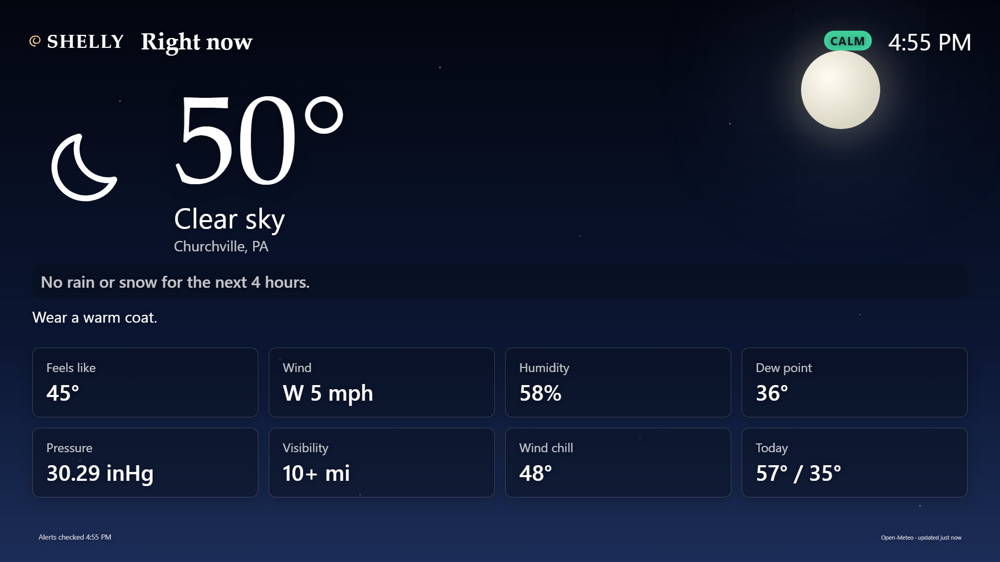
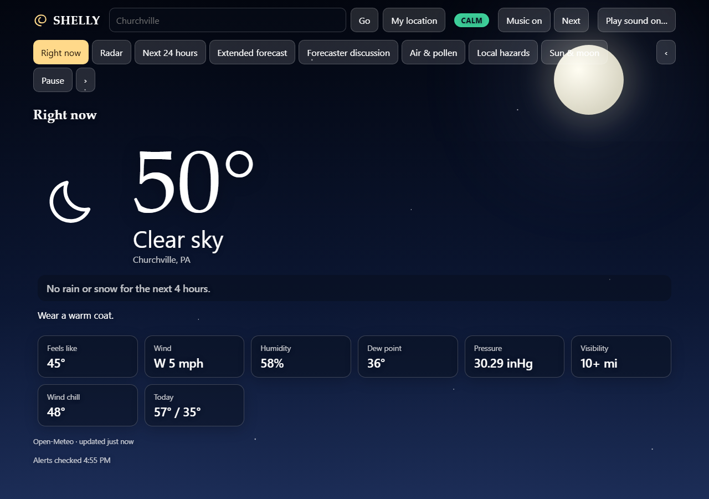
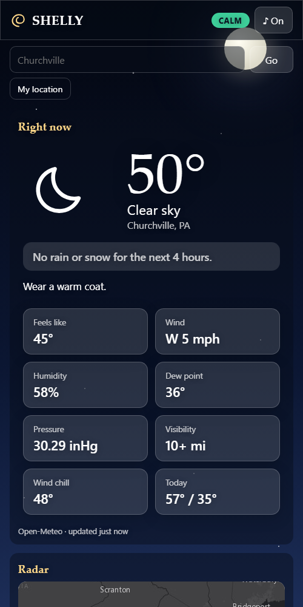

# SHELLY

**S**evere **H**ydrology & **E**nvironmental **L**ive **L**ogging **Y**earbook — a US-only live weather
display that gets louder when the weather does. Named after the author's grandmother.

SHELLY v2 is one Cloudflare Worker serving a Preact app and a small JSON API. The old v1 app is
tagged `legacy-v1`.

## Screenshots

| TV / kiosk | Desktop | Phone |
| --- | --- | --- |
|  |  |  |

## What it does

- Computes a **threat level** (CALM / ELEVATED / WARNING / EMERGENCY) from NWS alerts, the SPC
  outlook and a 15-minute nowcast (`shared/threat.ts`).
- The threat level changes the screen: a relaxed loop when calm, a shorter loop with radar and the
  SPC outlook when elevated, a radar-locked warning takeover with countdown and spoken read-out for
  warnings, and a full-screen takeover for emergencies (observed tornado, destructive storm, PDS,
  flash flood emergency).
- Three layouts: **kiosk/TV** (16:9 stage, auto-cycling), **desktop** (drive it yourself) and
  **phone** (scrollable cards, threat pinned). Force one with `?mode=kiosk|web|phone`.
- **What do I do right now:** plain steps for each alert, using the household's own shelter plan
  (admin > Display). Fixed safety text only; no AI ever writes it (`shared/actions.ts`).
- **Storm arrival at your address** from the warning's storm motion, and "warning 5 mi to your west,
  it does not cover you" for nearby warnings (`shared/eta.ts`).
- **Never fails silently:** if alert data is over 3 minutes old, every screen says "Alerts may be
  delayed". Admin shows how fast alerts arrive (NWS issue to SHELLY).
- **Rain starts in about 15 min** from 15-minute data, and a **what to wear** line on calm days.
- **Storm reports** (tornado, wind, hail) near you on their own segment and on the radar map.
- **Forecast confidence** from the 31-member GFS ensemble: ranges instead of fake precision.
- **SHELLY grades itself:** each morning it saves its forecast for the default location and
  checks it against the nearest NWS station the next day.
- **Local hazards:** river gauges with flood stages, tides, tropical storms, snow-day odds.
- **Push alerts** to phones and desktops, sent only when a warning's polygon covers the saved
  place. Off until the VAPID keys are set (below).

## Develop

```bash
npm install
npm run dev        # http://localhost:5173
npm run typecheck
npm test
npm run build
```

Trigger the alert poller locally: `curl http://localhost:5173/cdn-cgi/handler/scheduled`.

## Deploy

```bash
npm run deploy     # builds, then wrangler deploy
```

One `wrangler.jsonc` defines the Worker, static assets, the `STATE` KV namespace (auto-provisioned
on first deploy) and the every-minute alert-poller cron.

### Admin (announcements)

`/admin/` has a password login that sets a signed, HttpOnly session cookie (12 hours). Five bad
passwords from one IP locks that IP out for 15 minutes. It is **fail-closed**: with no password
configured, nobody can log in.

Set the password once as a Worker secret (it is never stored in the repo):

```bash
npx wrangler secret put ADMIN_PASSWORD
```

Changing the secret logs everyone out. For local dev, put `ADMIN_PASSWORD=...` in `.dev.vars`.

### Push alerts (optional)

Push stays off until these three secrets exist. Make a key pair locally (nothing is sent anywhere):

```bash
node scripts/gen-vapid.mjs
```

Then store them:

```bash
npx wrangler secret put VAPID_PUBLIC_KEY
```

```bash
npx wrangler secret put VAPID_PRIVATE_KEY
```

```bash
npx wrangler secret put VAPID_EMAIL
```

`VAPID_EMAIL` is a contact like `mailto:you@example.com` that push services can use. Changing
the keys later means every device has to tap "Alert me" again. On iPhone, push only works after
"Add to Home Screen". Admin > Overview has a "Send test push" button.

## Data sources

NWS (alerts, points, forecast text, station observations), Open-Meteo (forecast, nowcast, GFS
ensemble, air quality, pollen, geocoding), NOAA SPC (convective outlook, preliminary storm
reports), NWS National Water Prediction Service (river gauges), NOAA CO-OPS (tides), NHC (active
tropical storms), Iowa Environmental Mesonet (NEXRAD radar tiles), Esri (basemap). Clients never call these
directly except map and radar tiles. NWS requests carry
`SHELLY/2.0 (https://evaakselrad.com, nws@evaakselrad.com)`. 

# WARNING

IF YOU HOST THIS YOURSELF MAKE SURE YOU CHANGE THE TAG FOR NWS REQUESTS
